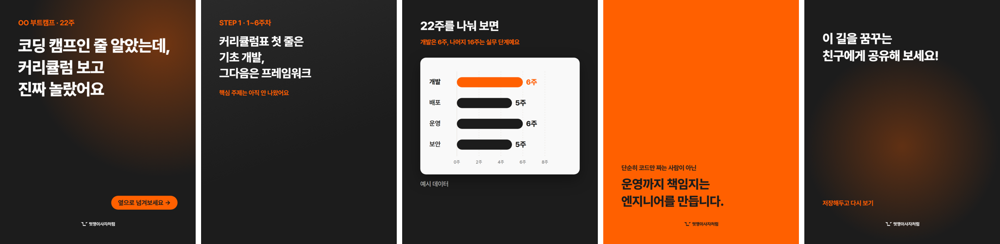
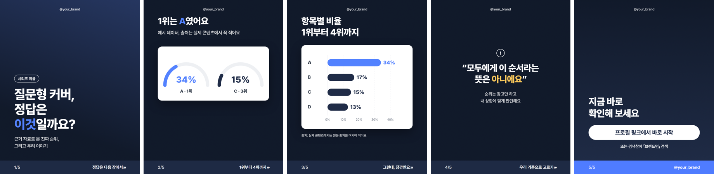

# 카드뉴스 생성 파이프라인 (cardnews-pipeline)

브랜드 담당자가 **브랜드 자산과 디자인 가이드를 한 번 입력**해 두면, 콘텐츠마다 **카피와 구성만 써서** 인스타그램 카드뉴스 PNG(1080×1350)를 만드는 파이프라인입니다. 렌더 직후 **여백 침범, 글자 크기 하한, 명암비를 자동 검수**합니다.




## 무엇을 합쳤나

마케팅본부에서 따로 쓰던 두 방식을 하나로 합쳤습니다.

| 출처 | 가져온 것 |
|---|---|
| 부트캠프 카드뉴스 시안 렌더러 (PIL) | 디자인 가이드 상수 분리, 로고 '잉크' 기준 배치, 여백 침범 검사, 배경 최악값(밝은 상위 2%) 기준 명암비 검사, 가독성 패널(scrim) |
| 브랜드 카드뉴스 렌더러 (HTML + Playwright) | HTML/CSS로 레이아웃, 사진 배경(풀블리드·블러·상단), SVG 차트, 상단 핸들·하단 티저 바·페이지 번호, 발행본까지 바로 출력 |

## 폴더 구조

```
cardnews-pipeline/
├── cardnews/            엔진 (건드리지 않아도 됨)
│   ├── render.py        brand.json + spec.json → HTML → PNG → 자동 검수
│   ├── audit.py         여백 · 글자 크기 · 명암비 검수
│   ├── charts.py        gauge(반원 게이지), bars(가로 막대) SVG
│   ├── base.css         공통 레이아웃과 컴포넌트(.panel .pill .scrim .btn ...)
│   └── prep_assets.py   원본 사진 리사이즈·누끼(선택)
├── brands/              브랜드 키트 (브랜드 담당자가 채움)
│   ├── likelion/        멋쟁이사자처럼 (BE 인스타그램 공통가이드 적용)
│   └── _template/       새 브랜드용 빈 키트 (복사해서 시작)
├── examples/            콘텐츠 예시 spec
│   ├── likelion-sample/
│   └── template-sample/
└── docs/                작성 가이드
```

## 빠른 시작

```bash
cd cardnews-pipeline
pip install -r requirements.txt
python -m playwright install chromium

# 샘플 렌더 (out/ 폴더에 PNG와 audit.json 생성)
python -m cardnews.render --brand brands/likelion --spec examples/likelion-sample/spec.json --out out/likelion-sample
```

- Windows, Mac 모두 동작합니다. 서체(Pretendard)는 웹폰트로 불러오므로 설치하지 않아도 됩니다. 인터넷 연결이 필요합니다.
- 일부 슬라이드만 다시 만들 때: `--only 03_data 05_end_instagram`
- 검수 실패 시 종료 코드 1을 받으려면: `--strict`

## 내 브랜드로 쓰는 순서

| 단계 | 할 일 | 문서 |
|---|---|---|
| 1 | `brands/_template/`을 복사해 `brands/내브랜드/`를 만든다 | |
| 2 | 디자인 가이드의 색, 서체, 글자 크기, 여백, 로고 규정을 `brand.json`에 옮긴다. 로고 PNG는 `assets/`에 넣는다 | [docs/BRAND_KIT.md](docs/BRAND_KIT.md) |
| 3 | 가이드 원문 요약을 `DESIGN_GUIDE.md`로 남긴다 (예: `brands/likelion/DESIGN_GUIDE.md`) | |
| 4 | 예시 spec을 복사해 내 콘텐츠의 슬라이드를 쓴다 | [docs/SPEC.md](docs/SPEC.md) |
| 5 | 렌더하고 검수 결과를 보고 고친다. 통과한 PNG를 업로드한다 | [docs/WORKFLOW.md](docs/WORKFLOW.md) |

## 검수 기준 (audit)

| 검사 | 기준 | 실패 시 |
|---|---|---|
| 여백 침범 | 모든 본문 글자가 `safe_area` 안에 있음 | 줄을 나눈다 → 그래도 넘치면 카피를 줄인다. 글자 크기는 가이드 값 아래로 내리지 않는다 |
| 글자 크기 하한 | `audit.min_font_px` 이상 | 하한 이상 크기로 올리거나 문구를 뺀다 |
| 명암비 | 글자색별 목표 이상. 배경은 평균이 아니라 글자 영역의 최악값(밝은 글자는 밝은 쪽 상위 2%) | 글자 뒤에 `.scrim` 가독성 패널을 깔거나, 배경을 어둡게 하거나, 글자색을 바꾼다 |

검수 결과는 터미널과 `out/.../audit.json`에 남습니다. SVG 차트 안 글자는 검수에서 제외되니, 차트는 밝은 `.panel` 안에 넣는 것을 기본으로 합니다.

## 원칙

- 브랜드 가이드의 확정 스펙(여백, 글자 크기, 로고)은 콘텐츠 사정으로 바꾸지 않습니다. 넘치면 카피를 고칩니다.
- 매체마다 행동 지시가 다르므로 마지막 장(엔드컷)은 매체별로 따로 만듭니다(인스타그램=공유·저장, 유튜브=검색).
- 수치를 넣는 차트는 슬라이드 안에 출처를 적습니다. 예시 spec의 수치는 모두 예시 데이터입니다.
